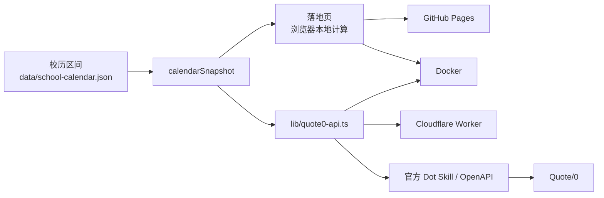
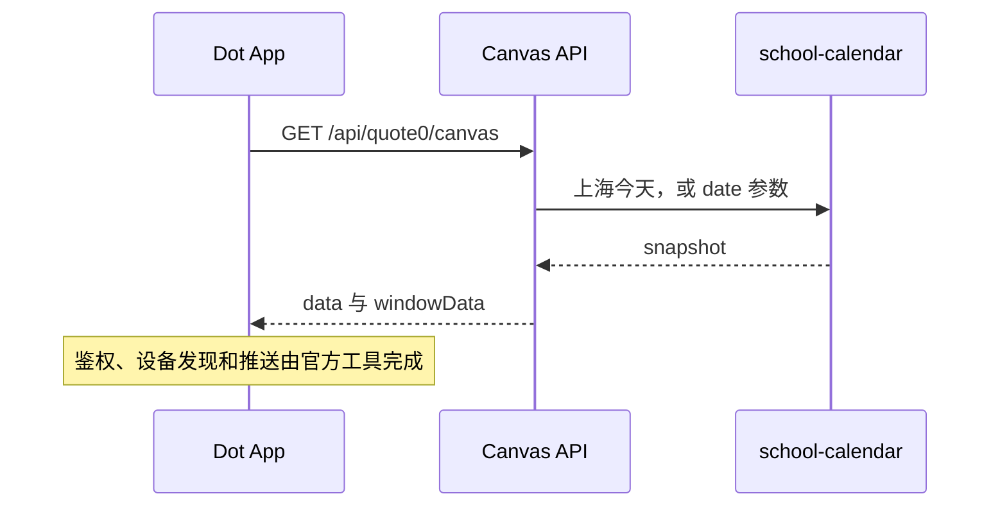
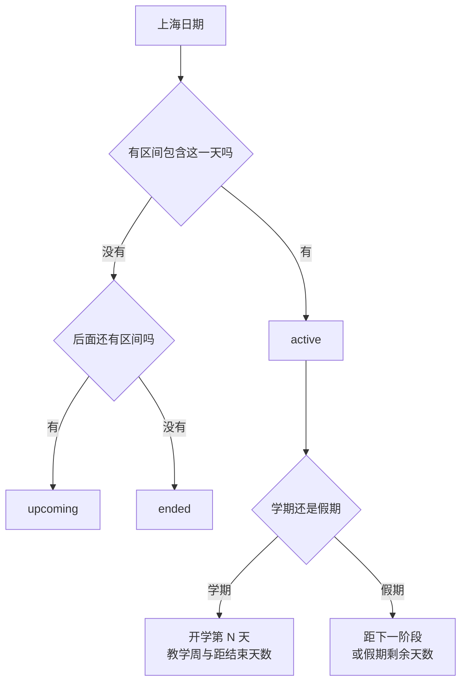
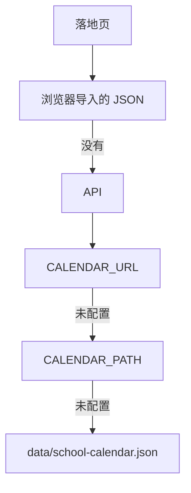

# 流程与日期逻辑

校历区间写在 `data/school-calendar.json`，日期计算写在 `lib/school-calendar.ts`。落地页、Docker 和 Cloudflare Worker 都调用这一份实现，不各自复制数据和模板。设备发现、鉴权和推送不在本仓库实现。

## 整体流程



一次设备刷新不经过落地页：



三条部署路径共用同一套计算：

| 路径 | 落地页 | API | 倒计时在哪里算 |
| --- | --- | --- | --- |
| GitHub Pages | 有 | 无，链接指向 Worker | 浏览器 |
| Cloudflare Worker | 无，`/` 返回健康检查 | 有 | Worker |
| Docker | 有 | 同源 | 页面在浏览器，接口在容器 |

模块边界：

```text
data/school-calendar.json  校历区间和来源
lib/school-calendar.ts      范围判断、教学周和缓存时间
lib/quote0-api.ts       REST 响应和 Quote/0 Canvas 负载
app/                    落地页；Docker 同时复用其中的 API 路由
worker/api.ts           Cloudflare Worker 的路径适配器
content-studio/         Quote/0 Content Studio 申报材料
```

## 日期逻辑

所有日期都按 `Asia/Shanghai` 解释。不传 `date` 时用上海的今天；传入的值必须是真实存在的 `YYYY-MM-DD`，`2026-02-30` 会返回 400。

已收录区间从 2025-09-01 到 2027-08-31，彼此衔接。计算时先找包含这一天的区间；找不到时，取之后最近的区间；再没有，就落在最后一个区间上。



三种范围的主数字：

| `range` | 含义 | 主文字 | 主数字 |
| --- | --- | --- | --- |
| `active` | 落在学期内 | 开学第 | 已开学天数，含当天 |
| `active` | 落在寒暑假，且后面还有区间 | 距春季开学 / 距秋季开学 | 距离下一区间开始的天数 |
| `active` | 落在最后一段假期 | 假期还剩 | 距离该假期结束的天数 |
| `upcoming` | 早于匹配区间，或处在区间缺口 | 距开学 / 距该阶段 | 距离该区间开始的天数 |
| `ended` | 晚于最后一天 | 结束后 | 超出收录的天数 |

学期的教学周从开学日所在周的周一开始数，按上海时区的周一到周日进周，并且不超过该学期登记的周数。假期没有教学周。这个算法不扣除法定假日和临时调休；那些安排以学校通知为准。

Canvas 负载不再另算一遍。它只把 snapshot 填进固定的 `windowData`：进行中时显示教学周或假期进度；`upcoming` 显示「尚未开学」；`ended` 显示「校历未收录」，并提示更新学年数据。

成功响应的缓存也按日期区分：

| 请求 | 共享缓存 |
| --- | --- |
| 不带 `date`，或 `date` 就是上海今天 | 到下一个上海零点为止，最长 1 小时 |
| 指定了其他合法日期 | 7 天 |
| `/api/health` | 不缓存 |

上海今天的响应带 `max-age=0`，浏览器不会留住它。落地页的倒计时也不走这层缓存，而是在本地调用同一份计算。静态页面在构建时写入当天的数字；页面水合后改用浏览器里的上海今天，并在下一个上海零点更新。GitHub Pages 会在每天 00:05（上海）重新构建，让没有执行脚本的访问也能看到当天的数字。

`GET /api/calendar-data` 在使用内置校历时缓存 1 小时，共享缓存 1 天。配置了 `CALENDAR_URL` 或 `CALENDAR_PATH` 时不缓存。`CALENDAR_URL` 出现超时、网络错误或 5xx 时，接口继续返回这个地址上一次成功拉到的校历。内容无效或 4xx 仍返回 `invalid_calendar`，不会退回内置校历。

## 替换校历

默认数据仍是 `data/school-calendar.json`。替换时沿用同一份 JSON 格式，日期仍按上海时区计算。地址优先于文件；都没配置时用内置数据。



浏览器里的「替换校历」只保存在这台浏览器，不会改变 Quote/0 设备读到的接口。设备要换校历，需要在部署时替换：

| 部署 | 替换方式 |
| --- | --- |
| Docker | `CALENDAR_FILE=./my-calendar.json docker compose up`，文件挂到容器内读取 |
| Cloudflare Worker | 设置 `CALENDAR_URL` 为 https JSON 地址 |
| GitHub Pages | 发布目录中的 `school-calendar.json`，或让页面指向已配置 `CALENDAR_URL` 的 Worker |

阶段 `id` 不能重复，日期不能重叠。区间之间的缺口仍按尚未开始处理。显式替换的接口响应不缓存。文件或地址无效时，接口返回 `invalid_calendar`，不会悄悄退回默认校历。
